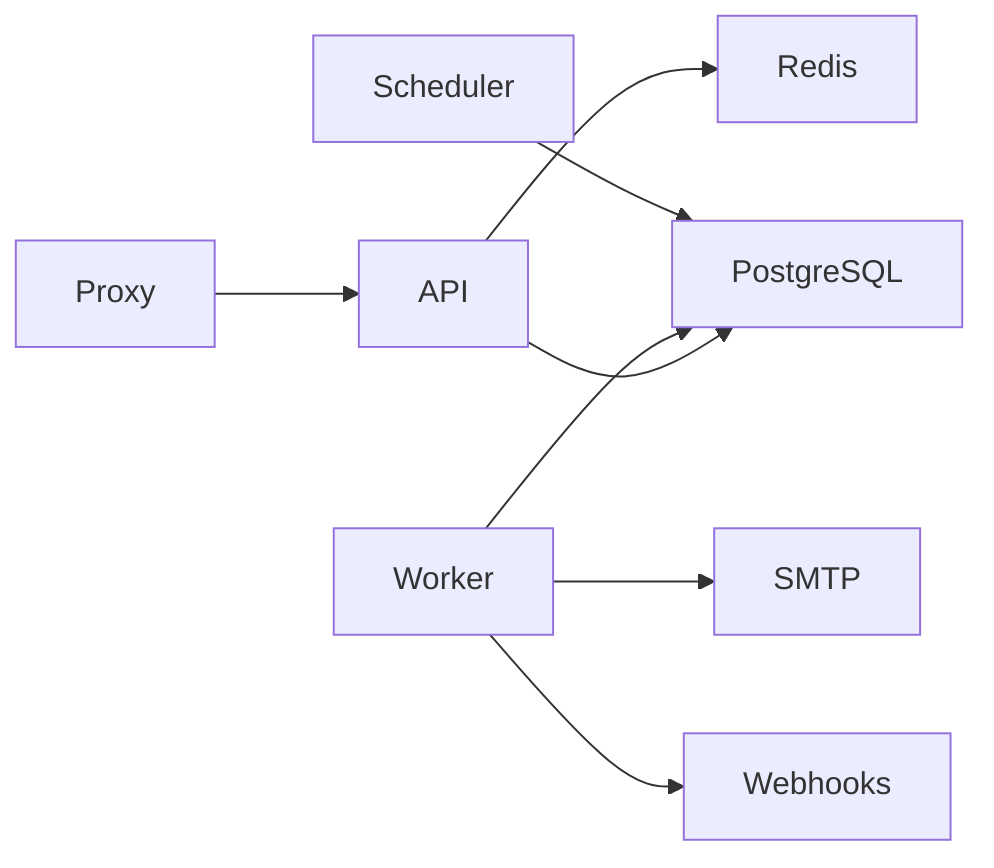
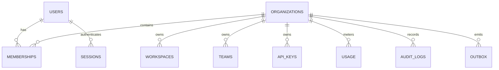
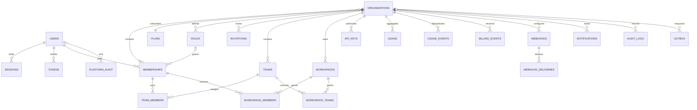

# Atlantik architecture and contracts

Decision record, written before endpoint implementation. TypeScript/Fastify provides validated versioned HTTP contracts. PostgreSQL is the source of truth; Redis provides distributed rate limits. A PostgreSQL transactional outbox is the durable queue so business changes and messages commit together. Separate workers use row locks with SKIP LOCKED, retries and dead letters. Docker Compose separates API, worker, scheduler, database, Redis, SMTP and reverse proxy.

Identity is global; membership, roles and resources are organization scoped. Sessions are random opaque bearer credentials stored as SHA-256 digests, expire after 24 hours, and can be independently revoked per device. Passwords use scrypt with random salt. Email verification/reset credentials expire after one hour and are single use. Password reset revokes every session. No implicit platform administrator access to customer resources. Platform control-plane endpoints require an independently provisioned platform flag.

Tenant transactions set a transaction-local organization identifier. Forced PostgreSQL RLS protects tenant tables even if an endpoint omits its filter. The runtime database role must be NOSUPERUSER NOBYPASSRLS and cannot own migrations. Composite foreign keys prevent cross-tenant relationships. Owners/admins/members map to permission sets; workspaces additionally require explicit membership for regular members. API keys are scoped, hashed, expiring bearer credentials, with no membership-management permissions. Suspended/deleted/pending organizations cannot operate. Unverified/suspended/deactivated users cannot authenticate for protected operations.

Free: 5 users, 3 workspaces, 10,000 requests/month, 1 GiB. Pro: 50 users, 25 workspaces, 500,000 requests/month, 50 GiB. Enterprise requires explicit configured limits. Quota decisions lock the organization row to prevent concurrent oversubscription. Usage periods use UTC calendar months. Billing events have globally unique provider IDs and commit once. Trial/past-due/cancelled/suspended semantics and grace periods require acceptance before payment integration.

API: /api/v1. Bearer session or API key plus X-Organization-Id. JSON errors contain code, message, details, requestId. Resource ID mismatches return 404. All requests receive server-generated request IDs. Passwords/tokens/authorization headers are redacted. Liveness does not access dependencies; readiness checks PostgreSQL and Redis and returns 503 on failure. Dependency failures fail closed.

Deployment gate: this repository is under construction, not production ready. Docker runtime tests, all acceptance scenarios, backup/restore, migration rollback strategy and external penetration review remain release gates.

## Implemented decision updates

- RLS also covers organization settings and records. Narrow security-definer functions recheck platform sessions and expose metadata/status controls only. Global identity and internal queue tables have separate privilege boundaries.
- Custom roles are tenant-owned permission sets evaluated at request time. Team membership grants only explicit workspace ACL access. Owners remain unique per organization and must be members through a deferred composite foreign key.
- AES-256-GCM encrypts queue payloads and webhook signing secrets. The API role can enqueue but cannot read queue payloads. Completed jobs erase sensitive payloads; a separate worker role processes them.
- Billing events are signed, deduplicated by provider ID and ordered by monotonic subscription version. Local checkout simulation is rejected in staging/production.
- PostgreSQL outbox jobs are at least once; stable event/message IDs support receiver deduplication. Row-lock claims roll back on worker connection/process loss. Retries stop after eight attempts. System jobs remain independent of customer job-budget exhaustion.
- PostgreSQL/Redis integration tests and actual service outage tests run against isolated Docker containers. Compose smoke tests exercise real SMTP, reverse proxy and process restart. Production acceptance remains a separate operational gate.

Platform configuration, service heartbeat and schedule-run tables are operational metadata without tenant/customer payloads. There is no hard-delete cascade for customer organizations; deletion is a tombstone and retention requires an explicit operator procedure.
